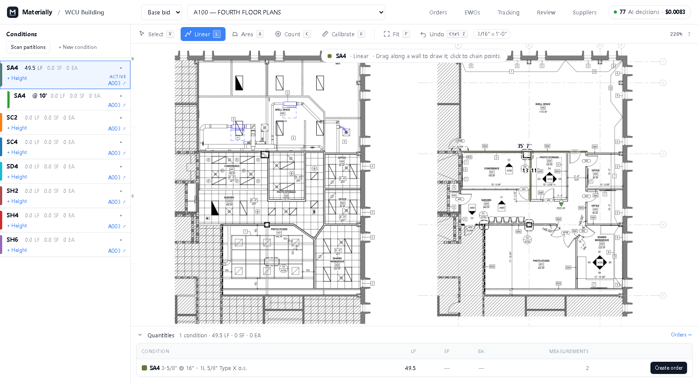
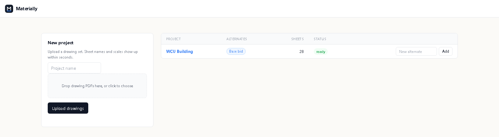
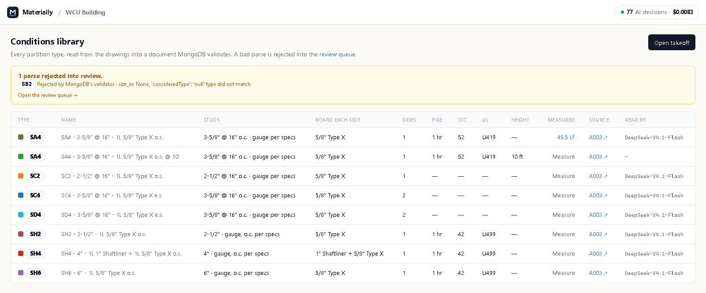
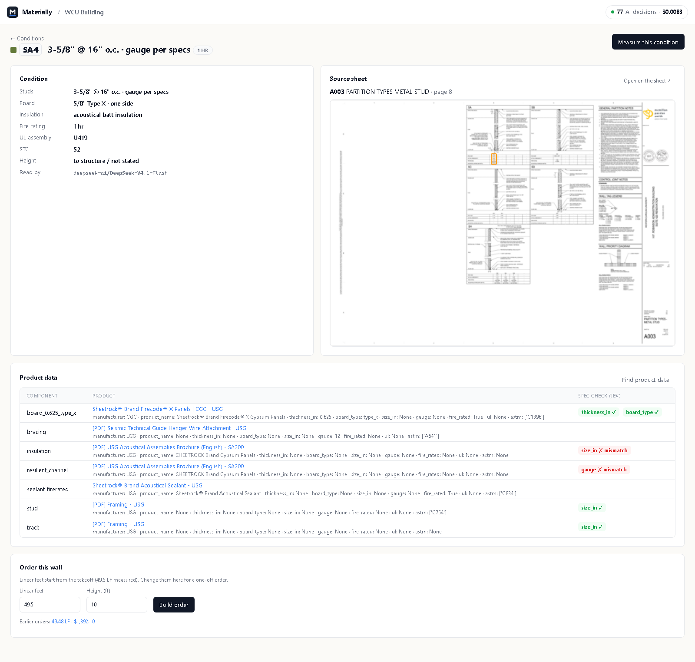
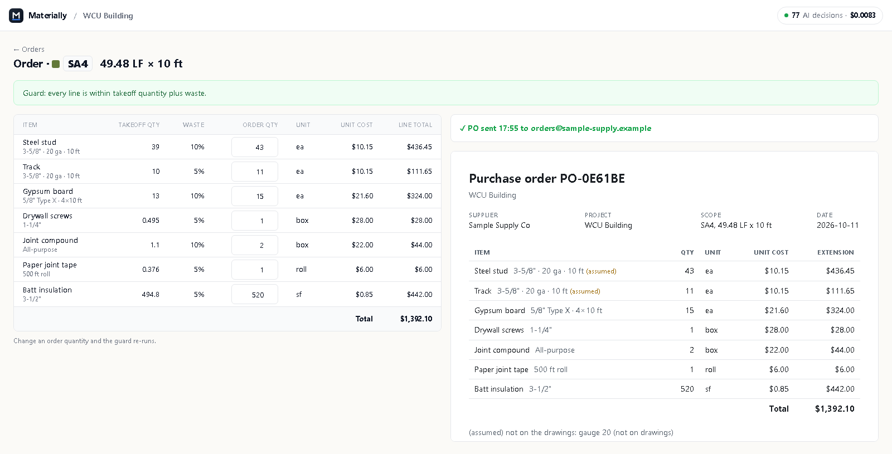

# Materially

Materially is a back office for drywall and framing contractors. Upload a drawing set and it sorts the sheets,
reads the partition-type sheet into a library of wall types ("conditions"), lets the estimator measure those walls
on the drawings, checks manufacturer product data against each wall's spec, and turns the measured footage into a
priced material order with an over-purchase guard and a PO for the supplier. It is built for **estimators** and
**project managers**, so that the drawings, the takeoff and the order stay in one place instead of being retyped
between takeoff software, spreadsheets and emails. Built at c0mpiled-15.


*The takeoff workspace: conditions on the left, measured walls on the sheet, running quantities below.*

## How it works

1. **Upload the drawing set.** Drop the PDFs on the Projects page. Every page becomes a sheet with its number,
   title and scale, and a decision model (Jev) sorts each sheet by kind: floor plan, partition types, RCP, details…

   
   *Projects: upload a set, then open it; each project has a Base bid and optional alternates.*

2. **Build the conditions library.** The partition-type sheet is read wall type by wall type (DeepSeek) into JSON:
   studs, board layers, sides, insulation, fire rating, UL assembly, STC. MongoDB's `$jsonSchema` validator checks
   every one; a bad read is rejected into the review queue with the reason. You can also add a condition by hand
   (**+ New condition**) or the same wall type at another height (**+ Height**).

   
   *The conditions library, with the parse MongoDB rejected (SB2) waiting in review.*

3. **Take off on the drawings.** Pick a condition and measure with **Linear**, **Area** or **Count**. **Measure**
   checks a distance against the sheet's scale, and if it's off, calibrates from the same two clicks. The ✎ on a
   condition edits it (a wall type's edit carries to its heights). The quantities drawer totals LF, SF and EA per
   condition.
   Alternates (Base bid, Alternate 1…) keep separate takeoffs on the same drawings, and the top bar opens Orders,
   Tracking, Review and Suppliers without leaving the sheet. (This is the screenshot at the top.)

4. **Pull and check product data.** Expand a condition (▸) to see the materials it is built from.
   **Pull product data** searches your supplier sites (Firecrawl; the **Suppliers** list sets which sites), extracts
   each product's attributes, and Jev checks every attribute against the condition: ✓ passes, ✗ is a likely
   mismatch. Each project searches fresh; inside a project a repeat search is reused, so it makes no Firecrawl call.

   
   *One condition (SA4): its build, where it is defined, and product data with Jev's spec checks.*

5. **Build the material order.** **Create order** turns measured LF × wall height × the wall build into lines
   (studs, track, board, screws, mud, tape, insulation…), each with a waste allowance and a price from the price
   book. The **over-purchase guard** flags any line that orders more than the takeoff plus waste; change a quantity
   and it re-runs. A gauge or spacing the drawings don't give gets a default and is marked "(assumed)".

6. **Send the PO.** **Send PO** renders the purchase order, records it in the `outbox` collection and locks the
   order against further edits. (Email delivery is off for now, so nothing leaves the app.)

   
   *An order for SA4: priced lines with waste, the guard passed, and the sent PO on the right.*

Every model call is logged in MongoDB, and the badge in the top bar shows how many AI decisions a job took and what
they cost. Anything a validator rejected, or a model wasn't sure about, waits in the **Review** queue.

**Under the hood:** Python 3.11+, FastAPI, Jinja2 templates with small vanilla JS, MongoDB Atlas. Jev
(`typesafe/jev-1.13`, via OpenRouter) only *picks* (sheet kind, spec mismatch) and never writes. DeepSeek
V4.1 Flash on Luminal, behind a local LiteLLM proxy, reads partition text; Sonnet is the one-time
retry when a result fails validation. The full design is in [docs/SPEC.md](docs/SPEC.md).

## Quickstart (Windows, PowerShell)

1. Install Docker Desktop, [uv](https://docs.astral.sh/uv/) and the Infisical CLI, and start Docker Desktop.
2. Start the local infra (Infisical on http://localhost:8080, LiteLLM on http://localhost:4000):
   ```powershell
   .\infra\up.ps1
   ```
   The first run generates `~/.c15/infra.env`. Once you have logged in (step 3) and stored the Luminal keys under
   the Infisical folder `/litellm`, run it again so LiteLLM picks them up.
3. Log in to the self-hosted Infisical (the project id is in `.infisical.json`):
   ```powershell
   infisical login --domain http://localhost:8080/api
   ```
4. Install the dependencies:
   ```powershell
   uv sync
   ```
5. Run the app with every key injected from Infisical, then open http://localhost:8000:
   ```powershell
   .\scripts\dev.ps1
   ```

**Where keys live.** Only in Infisical, environment `dev`; nothing secret goes in the repo.
The root folder `/` holds the app's keys (`MONGODB_URI`, `OPENROUTER_API_KEY`, `ANTHROPIC_API_KEY`,
`FIRECRAWL_API_KEY`, `LITELLM_BASE_URL`, `LITELLM_API_KEY`, …); `/litellm` holds `LUMINAL_BASE_URL` and
`LUMINAL_API_KEY`, which only the LiteLLM container sees. On a machine without Infisical, the same names can go in
`~/.c15/keys.env` (or the file named by `C15_KEYS`).

## Everyday commands

Every command that needs keys runs under `infisical run --env=dev -- ...`.

Set `DB_NAME` in the shell first. Each lane has its own database (`lane1`, `lane2`, `lane3`, `h1`, `h2`), and
`demo` is main's and the default. It is deliberately not stored in Infisical, because `infisical run` would
override a lane's value.

```powershell
uv run pytest -q                                                    # offline tests (mongomock)
$env:DB_NAME = "demo"; infisical run --env=dev -- uv run pytest -q  # also runs live_db tests on Atlas
infisical run --env=dev -- uv run python -m scripts.smoke           # one Jev call + one run_task, with usage rows
infisical run --env=dev -- uv run python -m contracts.setup_db      # validators, indexes, seeds on all six DBs
```

## Project layout

| Folder | What's in it | Owner |
|---|---|---|
| `app/` | FastAPI app, settings, MongoDB helpers, Jev client, model router (`run_task`) | integrator |
| `contracts/` | `$jsonSchema` validators, sample docs, seeds, `setup_db` | integrator |
| `infra/` | Docker Compose for local Infisical and LiteLLM | integrator |
| `scripts/` | `dev.ps1`, the smoke test, a synthetic drawing-set generator | integrator |
| `docs/` | build spec, screenshots | integrator |
| `extract/` | drawing set → sheets, scales, conditions, materials, rooms | lane 1 |
| `pipeline/` | measurements, orders and the guard, cost | lane 2 |
| `ui/` | the screens (Jinja templates, CSS, vanilla JS) | lane 3 |
| `procure/`, `po/` | product data and supplier sites; PO render and send | H1 |
| `orders/`, `eval/`, `demo/` | order math (`orders/math.py`); accuracy and demo script | H2 |
| `projects/` | the projects list and alternates (Base bid + named alternates) | — |
| `tests/` | tests per lane, in `tests/<lane>/` | each lane |

Each lane works in its own worktree and branch; changes to `app/` and `contracts/` go through the integrator.
Drawing PDFs and keys never go in git.

**More:** [docs/SPEC.md](docs/SPEC.md) (the build spec: flow, collections, models) ·
[contracts/README.md](contracts/README.md) (data contracts, conventions, shared calls, routes)
